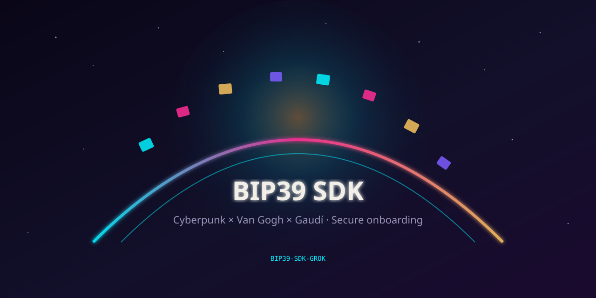

<p align="center">
  
</p>

# BIP39-SDK-GROK

**Onboarding BIP39 seguro listo para Android**  
Núcleo Rust · Jetpack Compose · Tink · biometría · 20 presets visuales

[English](README.md) · [Русский](README.ru.md) · [Español](README.es.md)

---

## Qué incluye

| Flujo | Funciones |
|-------|-----------|
| **Crear** | 12/24 palabras · aviso legal · backup en papel · quiz · PIN + panic PIN |
| **Restaurar** | Pegar · QR · PDF |
| **Desbloquear** | PIN · passphrase opcional · biometría · bloqueo de sesión |
| **Motor** | Rust primero, JVM de respaldo |
| **Aspecto** | 20 temas · pantalla Welcome Aboard |

## Inicio rápido

```kotlin
MnemonicEngines.preferRust()
OnboardingTheme(config = OnboardingThemePresets.config("neon_night")) {
  OnboardingNavHost(storage, onComplete = { payload -> /* claves */; payload.clear() })
}
```

## Temas

```kotlin
OnboardingThemePresets.config("gaudi_mosaic")
```

## Rust (opcional)

```bash
./scripts/doctor.sh
./scripts/build-rust-android.sh
```

Sin `.so`, el SDK usa Kotlin automáticamente.

## Scripts

`doctor.sh` · `build-rust-android.sh` · `verify-parity.sh` · `run-sample.sh` · **`push-to-github.sh`**

## Seguridad

[docs/SECURITY.md](docs/SECURITY.md) · MIT
