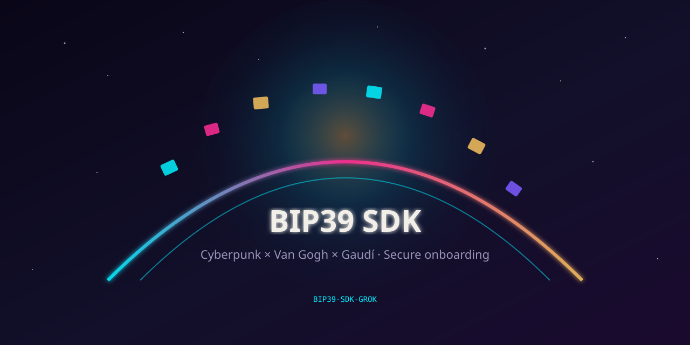

<p align="center">
  
</p>

> **Raster banner:** add `assets/banners/repo-banner.jpg` from the release pack, then point this image tag to it.

# BIP39-SDK-GROK

**SDK to bootstrap user accounts and supply root cryptographic keys for your app**

Create or restore a profile from a BIP39 seed, then hand a one-shot key payload to the host — wallets, E2E encryption, identity, anything that needs a strong local root.

Rust core · Android Compose · iOS SwiftUI · Tink · Biometrics · 20 themes

[English](README.md) · [Русский](README.ru.md) · [Español](README.es.md)

## Quick start

```kotlin
MnemonicEngines.preferRust()
OnboardingTheme(config = OnboardingThemePresets.config("neon_night")) {
  OnboardingNavHost(storage, onComplete = { payload -> /* derive keys */; payload.clear() })
}
```

## For coding agents

**[docs/AGENT_GUIDE.md](docs/AGENT_GUIDE.md)**

## Security

[docs/SECURITY.md](docs/SECURITY.md) · MIT
